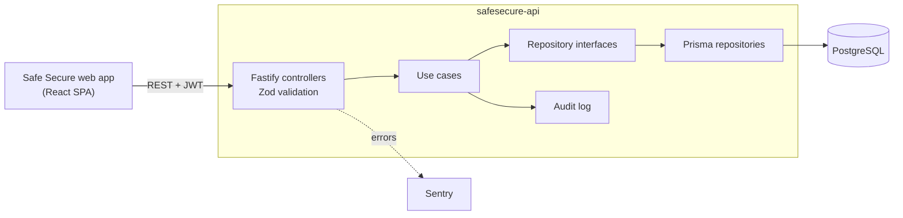

<div align="center">


# Safe Secure API

**REST API behind [Safe Secure](https://github.com/RanielliMontagna/safesecure-front), a tracker for safety equipment lent to employees.**


[Features](#features) •
[Architecture](#architecture) •
[Endpoints](#endpoints) •
[Running locally](#running-locally) •
[History](#project-history)

</div>

> [!WARNING]
> **Discontinued.** Safe Secure is no longer maintained. This repository is archived and kept as a portfolio reference. The hosted instance is offline.

<p align="center">
  
  <br />
  <sub>The web app built on this API. See <a href="https://github.com/RanielliMontagna/safesecure-front">safesecure-front</a> for more screenshots.</sub>
</p>

## About

This is the backend of Safe Secure, built in one week in September 2024 for a university project on workplace safety. It keeps the stock of protective equipment and tools, lends items to employees, takes them back, and records every change in an audit log.

Error messages are in Brazilian Portuguese, matching the web app.

## Features

- **Authentication**: email and password sign-in with bcrypt-hashed passwords and a 7-day JWT.
- **Categories, employees and equipment**: full CRUD with search, scoped to the signed-in user, with soft delete (`deleted_at`).
- **Allocations**: lend a quantity of an item to an employee with an optional due date, then mark it as returned. Available stock goes down and back up automatically, and the API refuses to lend more than is available.
- **Dashboard data**: active and overdue allocations, equipment and employee counts, allocations per weekday and the five latest allocations.
- **Audit log**: every create, update, delete and return writes a log entry with the action, the affected entity and a readable description.
- **Error tracking**: Sentry for unhandled errors.
- **API collection**: a [Bruno](https://www.usebruno.com/) collection in [`docs/`](docs) with all 25 requests and local/production environments.

## Architecture



```text
src/
├── http/
│   ├── controllers/     # routes and request validation per resource
│   └── middlewares/     # JWT verification
├── use-cases/           # business rules, domain errors and factories
├── repositories/        # interfaces and Prisma implementations
├── lib/                 # Prisma client and Sentry
└── env/                 # environment validation with Zod
prisma/
├── schema.prisma        # User, Category, Employee, Equipment, Allocation, Log
├── migrations/          # 7 migrations, September 11–17, 2024
└── seed.ts              # demo user
docs/                    # Bruno collection
```

## Endpoints

Every route except the health check and sign-in requires a `Bearer` token.

| Method | Route | Description |
| --- | --- | --- |
| `GET` | `/health-check` | Health check |
| `POST` | `/authenticate` | Sign in, returns a JWT |
| `GET` `POST` | `/categories` | List (with `?search=`) or create categories |
| `GET` `PUT` `DELETE` | `/categories/:id` | Read, update or delete a category |
| `GET` `POST` | `/employees` | List or create employees |
| `GET` `PUT` `DELETE` | `/employees/:id` | Read, update or delete an employee |
| `GET` `POST` | `/equipments` | List or create equipment |
| `GET` `PUT` `DELETE` | `/equipments/:id` | Read, update or delete equipment |
| `GET` `POST` | `/allocations` | List or create allocations |
| `GET` | `/allocations/:id` | Read an allocation |
| `PATCH` | `/allocations/:id/return` | Mark an allocation as returned |
| `GET` | `/allocations/dashboard` | Dashboard counters |
| `GET` | `/allocations/latest` | Five latest allocations |
| `GET` | `/allocations/week` | Allocations per weekday |
| `GET` | `/logs` | Audit log |

## Tech stack

| Area | Tools |
| --- | --- |
| Runtime | Node.js, TypeScript, tsx (dev), tsup (build) |
| HTTP | Fastify 4, `@fastify/jwt`, `@fastify/cors`, Zod |
| Data | Prisma 5, PostgreSQL |
| Observability | Sentry |
| Tooling | ESLint, Prettier, Docker, Bruno |
| Hosting | Render (no longer online) |

## Running locally

Last checked in October 2026 on Node.js 24 with PostgreSQL 17.

```bash
git clone https://github.com/RanielliMontagna/safesecure-api.git
cd safesecure-api
cp .env.example .env          # set JWT_SECRET; SENTRY_DSN is optional

# PostgreSQL (or: docker compose up -d)
docker run -d --name safe-secure-db -p 5432:5432 \
  -e POSTGRES_USER=docker -e POSTGRES_PASSWORD=docker -e POSTGRES_DB=safe-secure-db \
  postgres:17

npm ci
npx prisma generate
npx prisma migrate deploy
npx prisma db seed            # creates john@doe.com / safesecure
npm run dev                   # http://localhost:3333
```

Then run the [web app](https://github.com/RanielliMontagna/safesecure-front). CORS only allows `http://localhost:5173` and the old production URLs.

## Project history

- **September 11, 2024**: project setup, users and authentication.
- **September 12–14, 2024**: categories, employees, equipment and allocations.
- **September 15–16, 2024**: stock control on allocations, audit log and Sentry.
- **September 17–18, 2024**: search, dashboard endpoints and latest allocations.
- **October 2026**: archived; the seed now creates only a fictional demo user.

## Related

- [safesecure-front](https://github.com/RanielliMontagna/safesecure-front): the React web app.

## License

[MIT](LICENSE)
